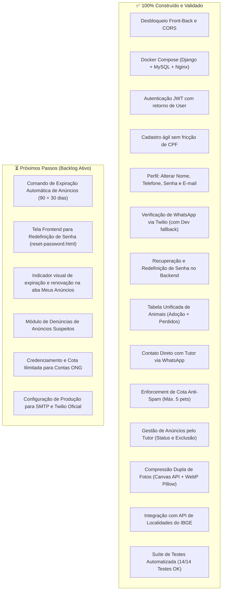

# 🗺️ MOC — Tarefas e Roadmap de Desenvolvimento
tags: #moc #roadmap #tarefas #planejamento #status #best-buddy

Bem-vindo ao índice central de **Tarefas, Execução e Roadmap** do **Best Buddy**.

Este módulo documenta o histórico de correções executadas, as tarefas técnicas de Frontend e Backend, os guias de execução local/Docker e o planejamento estratégico das próximas entregas do projeto.

---

## 📊 Status Atual do Ecossistema

O projeto passou por uma evolução arquitetural importante: **simplificação de atrito e unificação de tabelas**. 
- A intermediação burocrática de adoção foi substituída pelo **contato direto via WhatsApp com o tutor**.
- As entidades dispersas de animais perdidos e adoções foram unificadas na tabela `animais_animal` (`tipo_servico`: `ADOCAO` e `PERDIDO`).
- A compressão de imagens em **Dupla Camada (Canvas API + Pillow WebP)** foi implementada com economia de até 98% de banda e descarte de metadados EXIF/GPS.
- A integração com a **API de Localidades do IBGE** foi implementada com cache inteligente em memória e `sessionStorage`.
- A suíte automatizada de testes (`test_endpoints.py`) foi expandida para **14/14 testes cobrindo 100% dos fluxos**.

---

## 📑 Documentos Deste Módulo

| Arquivo | Descrição | Status |
| :--- | :--- | :---: |
| [[01 - Checklist de Correções Imediatas]] | Registro das correções emergenciais e desbloqueio Front-Back | 🟢 100% Concluído |
| [[02 - Tarefas Backend (Django)]] | Especificação técnica e código das tarefas Django (executadas e pendentes) | 🟡 Atualizado |
| [[03 - Tarefas Frontend (Melhorias)]] | Refinamentos de interface, UX, modais e pendências de tela | 🟡 Atualizado |
| [[04 - Guia de Execução e Testes]] | Passo a passo para rodar localmente e executar a suíte de 14 testes | 🟢 Operacional |
| [[05 - Configuração e Uso do Docker]] | Orquestração com Docker Compose (Django + MySQL 8.0 + Nginx) | 🟢 Operacional |
| [[06 - Guia de Alinhamento da Equipe e Novo Roadmap]] | Alinhamento de regras, histórico de sprints e novo roadmap (Sprints 4 e 5) | 🟡 Reestruturado |
| [[07 - Otimizacao de Imagens (Pillow e WebP)]] | Arquitetura técnica de compressão de imagens (Canvas API + Pillow WebP) | 🟢 100% Concluído |

---

## 🧭 Visão Rápida: O que Já Foi Construído vs O que Falta

---

## 🔗 Links Úteis e MOCs Relacionados
- [[00 - MOC (Início)]] — Mapa geral de todo o Vault.
- [[00 - MOC Requisitos e Modelagem]] — Especificação funcional completa (RFs, RNs e ERD).
- [[01 - Matriz de Funcionalidades (O que funciona)]] — Inventário funcional de testes.
