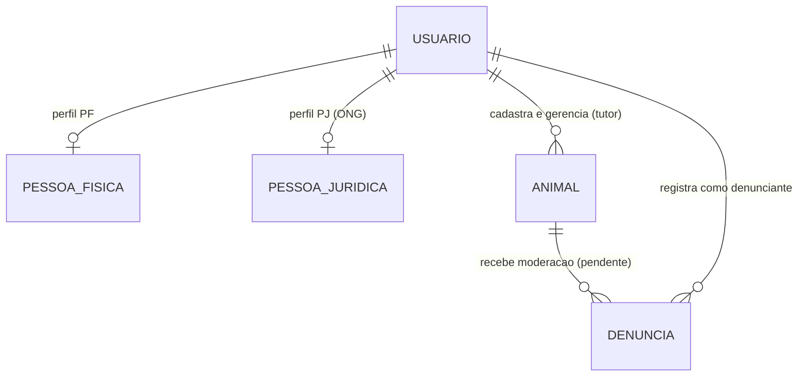

# 🤝 Guia de Alinhamento da Equipe e Novo Roadmap
tags: #roadmap #equipe #planejamento #arquitetura #regras-de-negocio #sprints #reestruturado

Este documento serve como **guia definitivo para reuniões da equipe e planejamento de entregas**. Ele consolida as decisões tomadas sobre regras de negócio, modelagem canônica de dados, fluxo de navegação e organização das sprints de desenvolvimento do **Best Buddy**.

---

## 🗣️ 1. Alinhamento de Visão e Boas Práticas do Time

### 🛑 As Três Regras de Ouro do Repositório (Git & Arquitetura)
1. **Separação Rígida entre Backend e Frontend**: 
   - Arquivos de tela, estilos e scripts residem exclusivamente em `frontend/`.
   - A raiz do repositório pertence ao Django (`animais/`, `usuarios/`, `config/`), Docker e automações.
2. **Trabalhar Sempre em Branches Feature/Fix**:
   - Evitar push direto na branch principal. Utilizar branches temáticas (ex: `feature/reset-password-page`, `feature/expirar-anuncios`, `fix/ibge-timeout`).
3. **Validação Obrigatória com a Suíte de Testes**:
   - Antes de abrir Pull Request ou realizar merge, executar obrigatoriamente:
     ```powershell
     python test_endpoints.py
     ```
   - Todos os 14 testes devem retornar com sucesso (`exit code 0`).

---

## 🔐 2. Níveis de Acesso e Matriz Canônica de Permissões

A arquitetura de permissões foi desenhada para oferecer **máxima conversão de adoções sem barreiras para visitantes**, protegendo a plataforma contra spam e abusos:

```mermaid
graph TD
    A[Visitante Não Logado] -->|Navegação Livre| B[Home: Carrossel, Destaques, Sobre]
    A -->|Navegação Livre| C[Vitrine de Pets: Adoção e Animais Perdidos]
    A -->|Navegação Livre| D[Ficha Detalhada do Pet e Filtros IBGE]
    A -->|Contato Imediato| E[Conversar via WhatsApp com Tutor]
    A -->|Tenta Anunciar| F[Redireciona para Login / Cadastro]

    G[Usuário Autenticado - PF] -->|Tudo do Visitante +| H[Anunciar Pet para Adoção - Cota até 5]
    G -->|Tudo do Visitante +| I[Reportar Pet Perdido - Cota até 5]
    G -->|Tudo do Visitante +| J[Aba Meus Anúncios: Marcar Adotado/Encontrado]
    G -->|Tudo do Visitante +| K[Excluir Próprios Anúncios]
    G -->|Tudo do Visitante +| L[Meu Perfil: Validar WhatsApp via Twilio]

    M[ONG Homologada / Admin - PJ] -->|Tudo do Usuário +| N[Cota Ilimitada de Anúncios de Pets]
    M -->|Tudo do Usuário +| O[Fila de Moderação de Denúncias no Admin]
```



### Detalhamento das Permissões por Perfil:
| Funcionalidade | Visitante (Sem Login) | Usuário Logado (PF) | ONG / Admin (PJ) |
| :--- | :---: | :---: | :---: |
| Visualizar Home, Carrossel e Banners | 🟢 Sim | 🟢 Sim | 🟢 Sim |
| Navegar no Catálogo de Adoção e Perdidos | 🟢 Sim | 🟢 Sim | 🟢 Sim |
| Filtrar por Estado e Cidade (IBGE) | 🟢 Sim | 🟢 Sim | 🟢 Sim |
| Visualizar Ficha Técnica do Animal | 🟢 Sim | 🟢 Sim | 🟢 Sim |
| **Conversar com Tutor via WhatsApp** | 🟢 Sim | 🟢 Sim | 🟢 Sim |
| **Anunciar Pet para Adoção** | 🔴 Exige Login | 🟢 Sim (Cota de 5) | 🟢 Sim (Ilimitado) |
| **Reportar Pet Perdido** | 🔴 Exige Login | 🟢 Sim (Cota de 5) | 🟢 Sim (Ilimitado) |
| **Marcar Pet como Adotado / Encontrado** | 🔴 Não | 🟢 Sim (Apenas próprios) | 🟢 Sim |
| **Excluir Próprio Anúncio** | 🔴 Não | 🟢 Sim (Apenas próprios) | 🟢 Sim |
| **Denunciar Anúncio Suspeito** | 🔴 Exige Login | 🟢 Sim | 🟢 Sim |
| **Acessar Painel Django Admin** | 🔴 Não | 🔴 Não | 🟢 Sim (Staff/SuperUser) |

---

## 🗄️ 3. Arquitetura de Dados Canônica (Schema Atual do Banco)

O banco de dados foi simplificado para eliminar tabelas redundantes, concentrando o núcleo da aplicação em entidades coesas:



### Entidades em Produção:
1. **`Usuario` (`usuarios_usuario`):**
   - `id`, `email` (único), `password`, `tipo` (`PF` ou `PJ`), `telefone` (único), `telefone_validado` (booleano), datas.
2. **`PessoaFisica` (`usuarios_pessoafisica`):**
   - `usuario_id` (FK 1:1), `nome`, `telefone`.
3. **`PessoaJuridica` (`usuarios_pessoajuridica`):**
   - `usuario_id` (FK 1:1), `cnpj` (único), `razao_social`, `nome_fantasia`, `telefone`, `endereco_id`.
4. **`Animal` (`animais_animal` - Tabela Unificada):**
   - `id`, `tutor_id` (FK `Usuario`), `tipo_servico` (`ADOCAO` ou `PERDIDO`), `tipo_animal` (`CACHORRO`, `GATO`, `OUTRO`).
   - `nome`, `estado` (Enum 27 UFs), `cidade` (IBGE), `telefone_contato`, `@property contato`.
   - `descricao`, `imagem` (WebP otimizado), `status` (`DISPONIVEL`, `ADOTADO`, `PERDIDO`, `ENCONTRADO`, `INATIVO`).
   - `raca`, `sexo`, `idade_aproximada`, `medicamento`, `castrado`, `local`.
   - `inativado_em` (data para rotina de expiração), `created_at`, `updated_at`.

---

## 💡 4. Registro de Decisões de Produto Tomadas pela Equipe

### Decisão 1: Contato Direto via WhatsApp vs Formulário Burocrático de Adoção
* **Problema:** O formulário de 5 etapas gerava alto índice de desistência e exigia um painel administrativo complexo para as ONGs responderem propostas.
* **Solução Adotada:** Conexão direta e instantânea com o tutor via WhatsApp. Ao clicar em *"Quero Adotar"*, o WhatsApp web/app abre com os dados do pet pré-preenchidos. A rota `/api/adocoes/` foi descontinuada com segurança.

### Decisão 2: Tabela Única de Animais vs App Comunidade Fragmentado
* **Problema:** Ter animais desaparecidos no app `comunidade` e animais para adoção no app `animais` duplicava endpoints, formulários e lógica de busca geográfica.
* **Solução Adotada:** Centralização no modelo `Animal` via campo `tipo_servico` (`ADOCAO` ou `PERDIDO`). As vitrines filtram pela mesma tabela e o app `comunidade` foi descontinuado.

### Decisão 3: Acesso Aberto para Visitantes
* **Problema:** O antigo script `auth-guard.js` bloqueava até a página inicial do site, forçando login de imediato.
* **Solução Adotada:** `auth-guard.js` removido das páginas públicas (`home`, `animals`, `community`). Visitantes navegam livremente e só são convidados ao login se tentarem criar anúncios ou gerenciar perfil.

### Decisão 4: Compressão Dupla de Fotos e Conformidade com LGPD
* **Problema:** Fotos de smartphone (5 MB a 25 MB) travavam conexões 4G e continham metadados EXIF com coordenadas GPS da casa do usuário.
* **Solução Adotada:** O frontend usa Canvas API nativo para converter em WebP (1080px, ~150 KB) expurgando EXIF/GPS antes do upload. O backend possui Fast-Path para salvar instantaneamente sem recompressão.

---

## 🗺️ 5. Histórico de Sprints e Novo Roadmap de Execução

### ✅ Sprint 1: Liberação do Acesso Público e Experiência do Visitante (Concluída)
- [x] **Frontend:** Remoção de `auth-guard.js` de `home/index.html`, `community/index.html` e `animals/index.html`.
- [x] **Frontend:** `Navigation.js` atualizada com dois estados visuais (Visitante com "Entrar/Cadastre-se" vs Autenticado com saudação e "Sair").
- [x] **Frontend:** Botão "Sair" limpando sessão e recarregando no modo visitante.
- [x] **Frontend / UX:** Descontinuação do link solto de adoção na navbar em favor do botão direto no card do pet.

### ✅ Sprint 2: Unificação de Animais, Filtros IBGE e Compressão de Imagens (Concluída)
- [x] **Backend:** Tabela `Animal` unificada para Adoção e Perdidos (`tipo_servico`).
- [x] **Backend:** Descontinuação segura dos apps legados `comunidade` e `adocoes`.
- [x] **Backend & Frontend:** Pipeline de otimização de imagens em Dupla Camada (Canvas API + Pillow WebP).
- [x] **Frontend:** Integração com a API de Localidades do IBGE (`ibgeService.js`) com cache duplo e autocompleção.
- [x] **Frontend:** Substituição dos `prompt()` por modais modernos com Tailwind em `animals/index.html`.

### ✅ Sprint 3: Gestão pelo Tutor, WhatsApp Direto e Segurança do Usuário (Concluída)
- [x] **Backend:** Validação de WhatsApp via Twilio Verify (com fallback dev para testes).
- [x] **Backend:** Recuperação e redefinição de senhas com tokens criptográficos assinados.
- [x] **Backend:** Enforcement de cota de até 5 anúncios ativos por usuário comum.
- [x] **Backend:** Permissões restritas de `PATCH` e `DELETE` em `animais/views.py` (apenas o tutor pode editar/excluir).
- [x] **Frontend:** Aba *"👤 Meus Anúncios"* com gerenciamento de status (`ADOTADO`/`ENCONTRADO`) e exclusão pelo tutor.
- [x] **QA & Testes:** Suíte automatizada `test_endpoints.py` expandida e validada com 14/14 testes com êxito.

---

### 🎯 Sprint 4: Ciclo de Vida dos Anúncios e Tela de Redefinição de Senha (Próximo Passo Imediato)
*Foco: Fechamento de ciclo de vida de dados e finalização da interface de recuperação de conta.*

- [ ] **Backend:** Criar o comando Django `animais/management/commands/expirar_anuncios.py`:
  - Anúncios com mais de 90 dias passam para `status = 'INATIVO'` com timestamp `inativado_em = now()`.
  - Anúncios inativos há mais de 30 dias (120 dias no total) são excluídos definitivamente do banco com suas imagens.
- [ ] **Frontend:** Criar a tela `pages/auth/reset-password.html` e script `js/pages/reset-password.js`:
  - Capturar `?token=...` da URL.
  - Campos de nova senha e confirmação com validação client-side.
  - Submeter para `POST /api/usuarios/redefinir-senha/` e redirecionar para o login com toast de sucesso.
- [ ] **Frontend:** Adicionar indicador de dias restantes e botão *"🔄 Renovar Anúncio"* na aba *"Meus Anúncios"*.
- [ ] **QA:** Adicionar teste unitário do comando de expiração na suíte `test_endpoints.py`.

---

### 🎯 Sprint 5: Módulo de Denúncias, Cota para ONGs e Produção
*Foco: Moderação comunitária, escalabilidade institucional e deploy final.*

- [ ] **Backend:** Criar modelo `Denuncia` em `animais/models.py` e endpoint `POST /api/animais/{id}/denunciar/`.
- [ ] **Frontend:** Adicionar botão *"🚨 Denunciar"* no card/detalhe com modal Tailwind e seleção de motivo.
- [ ] **Backend:** Implementar privilégio de cota ilimitada de anúncios para contas de Pessoa Jurídica / ONGs homologadas.
- [x] **Backend / IA:** Implementar validador de fotos com YOLOv8-nano e OpenNSFW2 com fallback resiliente e telemetria estruturada (`animais/utils.py`).
- [ ] **Compliance, LGPD e Termos (Opção A):** Implementar Termos de Adesão, Política de Privacidade e Banner de Cookies conforme [[09 - Privacidade, Dados Sensiveis (LGPD) e Termos de Adesao]]:
  - [ ] Páginas estáticas dedicadas `frontend/pages/legal/terms.html` e `privacy.html`.
  - [ ] Banner flutuante de armazenamento essencial/cookies (`CookieBanner.js`).
  - [ ] Checkbox bloqueante no cadastro (`register.html`) e modal de leitura rápida (`TermsModal.js`).
  - [ ] Disclaimer de responsabilidade e autorização de WhatsApp nos modais de cadastro de pets (`animals/index.html`).
  - [ ] Campo de auditoria de aceite no modelo `Usuario` (`termos_aceitos_em`).
- [ ] **Frontend / Compliance:** Auditoria e substituição das fotos do Hero Carousel (`assets/images`) por imagens com licença livre comprovada (Unsplash/Pexels) ou fotos reais, com criação de `frontend/assets/images/CREDITS.md` para conformidade jurídica.
- [ ] **DevOps:** Configuração das variáveis de ambiente de produção no `.env` (Twilio oficial e servidor SMTP).

---

## 👥 Divisão de Tarefas Sugerida para o Time

- **Desenvolvedor Frontend (Telas e UX):**
  - Construir `frontend/pages/auth/reset-password.html` e `reset-password.js` (Sprint 4).
  - Adicionar o badge de contagem regressiva de expiração dos 90 dias na aba *"Meus Anúncios"* (Sprint 4).
  - Desenhar o modal de denúncia com Tailwind (Sprint 5).

- **Desenvolvedor Backend (Django e Banco):**
  - Implementar o comando `expirar_anuncios.py` em `animais/management/commands/` (Sprint 4).
  - Criar o modelo `Denuncia` e endpoint de denúncia (Sprint 5).
  - Implementar a liberação de cota ilimitada para contas PJ (Sprint 5).

- **Líder Técnico / DevOps (QA e Infra):**
  - Manter a integridade de `test_endpoints.py` após a criação de novos endpoints.
  - Configurar as credenciais reais no ambiente de homologação/produção do Docker Compose.

---

## 🔗 Próximas Notas Relacionadas
- [[00 - MOC Tarefas e Roadmap]]
- [[01 - Checklist de Correções Imediatas]]
- [[02 - Tarefas Backend (Django)]]
- [[03 - Tarefas Frontend (Melhorias)]]
- [[04 - Guia de Execução e Testes]]
- [[05 - Configuração e Uso do Docker]]
- [[07 - Otimizacao de Imagens (Pillow e WebP)]]
