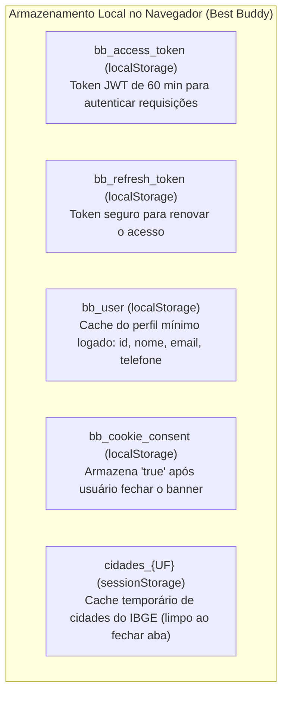

# 🛡️ Privacidade, Dados Sensíveis (LGPD), Modais e Termos de Adesão
tags: #lgpd #privacidade #termos-de-uso #cookies #seguranca #modais #arquitetura #best-buddy

Este documento detalha o tratamento de **Privacidade, Proteção de Dados (LGPD — Lei nº 13.709/2018)**, a **Política de Armazenamento Local / Cookies**, os **Termos de Adesão à Adoção Responsável** e a especificação de todos os **Modais e Componentes de Consentimento** da plataforma **Best Buddy** (Abordagem Completa e Detalhada — Opção A).

---

## 📌 1. Contexto Regulatório e Papéis da Plataforma

O Best Buddy atua como ecossistema facilitador entre tutores, protetores independentes, ONGs e adotantes:

* **Controlador dos Dados Cadastrais:** O Best Buddy é responsável pela guarda segura das credenciais de acesso, e-mail e hash de senhas de seus usuários cadastrados.
* **Operador e Facilitador da Conexão Peer-to-Peer:** A plataforma apenas provê a vitrine e viabiliza o contato direto via WhatsApp entre as partes. **O Best Buddy não intermedia transações financeiras, não comercializa animais e não é depositário ou proprietário dos pets anunciados.**
* **Bases Legais de Tratamento (Art. 7º da LGPD):**
  1. *Execução de Contrato / Procedimentos Preliminares (Inciso V):* Manutenção da conta de usuário, autenticação JWT e publicação de anúncios solicitados pelo próprio titular.
  2. *Consentimento Explícito (Inciso I):* Aceite dos Termos de Uso no cadastro e autorização para exibição voluntária do número de WhatsApp na vitrine pública de anúncios.
  3. *Legítimo Interesse (Inciso IX):* Armazenamento de tokens de sessão, prevenção a fraudes/spam (cota de 5 pets) e rotina de inativação de anúncios abandonados (90+30 dias).

---

## 🔍 2. Inventário de Dados: Mapeamento de Dados Sensíveis e PII

A tabela a seguir discrimina todos os dados coletados pelo sistema, seu nível de sensibilidade, visibilidade e ciclo de vida:

| Dado Coletado | Classificação | Visibilidade | Finalidade no Sistema | Base Legal (LGPD) | Ciclo de Vida / Retenção |
| :--- | :---: | :---: | :--- | :---: | :--- |
| **Nome Completo** | Pessoal Comum | Privado (exceto saudação e autor do pet) | Identificação do usuário e saudação na Navbar. | Execução de Contrato | Retido enquanto a conta estiver ativa. |
| **E-mail** | Pessoal Comum (PII) | Privado / Sigiloso | Login único no sistema, recuperação de senha e notificações de expiração. | Execução de Contrato | Retido enquanto a conta estiver ativa. Não é compartilhado. |
| **Senha** | Credencial Crítica | Estritamente Secreta | Autenticação no sistema. | Execução de Contrato | Armazenada com **Hash PBKDF2 com HMAC SHA-256** e salt aleatório. Impossível de ser lida por humanos. |
| **Telefone / WhatsApp** | Pessoal Comum (PII) | **Público no Anúncio** (com autorização expressa) | Contato direto via WhatsApp com adotantes e interessados no resgate de animais perdidos. | Consentimento + Execução de Contrato | Fica público apenas enquanto o anúncio estiver com status `DISPONIVEL` ou `PERDIDO`. Ocultado ao inativar/adotar. |
| **Fotos com Imagem de Pessoas** | Imagem Pessoal | Pública no Card | Tutores e voluntários que tiram fotos abraçados com o animal. | Consentimento (Termos de Uso) | Exibida no anúncio. A IA ([animais/utils.py](file:///c:/Users/T480/Documents/GitHub/BestBuddy/Best_Buddy/animais/utils.py)) valida presença do pet sem armazenar PII nos logs. |
| **Geolocalização (UF e Cidade)** | Dado Cadastral | Pública | Filtros regionais de adoção (integração com API de Localidades do IBGE). | Legítimo Interesse | Vinculado ao anúncio. |
| **Coordenadas GPS (EXIF)** | Dado Crítico de Localização | **ELIMINADO NA ORIGEM** | Localização exata da residência do tutor. | Privacidade por Design | **Purgado 100% no navegador e no backend**. Jamais persiste no banco ou disco. |

---

### 2.1 Privacidade por Design em Dupla Camada (EXIF/GPS)

Mesmo no cenário de falha da Canvas API no navegador do cliente (ou envio direto via API REST ou Django Admin), a privacidade do tutor está duplamente protegida:

1. **Camada 1 (Frontend — Canvas API):** O utilitário `image-compressor.js` redesenha os pixels em canvas 2D limpo, expurgando EXIF/GPS na memória RAM antes do tráfego de rede.
2. **Camada 2 (Backend — Pillow Fallback):** Caso o arquivo chegue sem minificação prévia, a função `otimizar_imagem_animal()` em `animais/utils.py` recodifica a imagem com Pillow para WebP em um buffer `io.BytesIO()`. O Pillow **não transporta metadados EXIF por padrão**, garantindo que nenhum dado de GPS seja persistido em `media/animais/`.

---

### 2.2 Telefone como Dado Público Voluntário e Repasse de Responsabilidade

* **Marco Civil da Internet (Lei nº 12.965/2014, Art. 19):** Plataformas de internet não respondem civilmente por danos decorrentes de dados inseridos por seus usuários, desde que removam conteúdos mediante notificação ou ordem judicial.
* **Prevenção a Falsa Identidade e Doxxing (Código Penal, Art. 307 e LGPD, Art. 42):** É expressamente vedado cadastrar números de terceiros sem autorização.
* **Barreira Técnica do Twilio Verify:** O usuário não consegue inserir números arbitrários nos anúncios, pois o contato do pet é herdado via Foreign Key (`animal.tutor.telefone`), exigindo validação via código PIN de WhatsApp.

---

## 🍪 3. Política de Cookies e Armazenamento Local (Client-Side Storage)

O Best Buddy adota uma política de **Impacto Zero de Rastreamento**. O sistema **não utiliza cookies de terceiros** (Meta Pixel, Google Analytics invasivo, trackers de afiliados).

Todo o armazenamento no cliente opera com mecanismos nativos do HTML5 (`localStorage` e `sessionStorage`), enquadrados como **Estritamente Necessários** pela ANPD:



### 3.1 O que Acontece se o Usuário Rejeitar o Armazenamento?

* **O que NÃO quebra (Modo Visitante Pleno):**
  A navegação pública na Home, filtros regionais do IBGE, visualização de fichas técnicas de pets e o clique para conversar com o tutor no WhatsApp **continuam funcionando 100% sem nenhuma interrupção**, pois não exigem autenticação.
* **O que fica inviabilizado:**
  A criação de anúncios, gestão de pets e edição de perfil dependem dos tokens JWT. Caso o navegador bloqueie o `localStorage` por completo, a sessão do usuário não pode ser persistida entre telas.
* **Enquadramento Legal (ANPD):**
  Como o armazenamento é estritamente operacional para manter o usuário logado (*Execução de Contrato*), o banner funciona como **Aviso de Transparência** com botão `[Entendi e Continuar]`, sem a necessidade de consentimento prévio impeditivo para navegar.

---

## 🖥️ 4. Especificação dos Modais e Componentes de Interface (Opção A)

A abordagem completa integra **5 componentes de interface** distribuídos estrategicamente na jornada do usuário:

```
┌────────────────────────────────────────────────────────────────────────┐
│  1. BANNER FLUTUANTE DE COOKIES (Global em todas as páginas)           │
│  "Utilizamos armazenamento essencial para manter sua sessão..."        │
└────────────────────────────────────────────────────────────────────────┘
                                    │
                                    ▼
┌────────────────────────────────────────────────────────────────────────┐
│  2. CHECKBOX DE ACEITE NO CADASTRO (register.html)                     │
│  [x] Li e aceito os Termos de Uso e a Política de Privacidade          │
└────────────────────────────────────────────────────────────────────────┘
                                    │
                                    ▼
┌────────────────────────────────────────────────────────────────────────┐
│  3. MODAL DE LEITURA RÁPIDA DE TERMOS (TermsModal)                     │
│  Drawer/Pop-up para leitura sem perder o formulário preenchido         │
└────────────────────────────────────────────────────────────────────────┘
                                    │
                                    ▼
┌────────────────────────────────────────────────────────────────────────┐
│  4. DISCLAIMER NOS MODAIS DE PETS (animals/index.html)                 │
│  Declaração de Adoção Responsável, Legitimidade e Prevenção Ambiental  │
└────────────────────────────────────────────────────────────────────────┘
                                    │
                                    ▼
┌────────────────────────────────────────────────────────────────────────┐
│  5. PÁGINAS DEDICADAS E RODAPÉ (pages/legal/ + Footer.js)              │
│  /pages/legal/terms.html e /pages/legal/privacy.html                   │
└────────────────────────────────────────────────────────────────────────┘
```

---

### 4.1 Componente 1: Banner Flutuante de Cookies (`CookieBanner.js`)

* **Local de Execução:** Global (carregado dinamicamente no rodapé das páginas).
* **Posição Visual:** Canto inferior direito (`fixed bottom-4 right-4 z-50 max-w-md`) com animação suave e design Tailwind.
* **Gatilho de Renderização:**
  ```javascript
  if (localStorage.getItem("bb_cookie_consent") !== "true") {
      // Renderiza o banner flutuante
  }
  ```
* **Elementos da Interface:**
  - Ícone amigável: `🍪`
  - Texto conciso: *"Utilizamos armazenamento local exclusivamente para manter você conectado e garantir a melhor experiência de navegação. Ao continuar navegando, você concorda com nossos [Termos de Uso] e [Política de Privacidade]."*
  - Botão Primário: `[Entendi e Continuar]` (Grava `bb_cookie_consent = 'true'` e remove o banner com animação de fadeOut).
  - Link Secundário: `[Saiba mais]` (abre `/pages/legal/privacy.html`).

---

### 4.2 Componente 2: Checkbox Obrigatório no Registro (`register.html`)

* **Local:** Imediatamente antes do botão *"Criar conta"* em `frontend/pages/auth/register.html`.
* **Comportamento:**
  - Checkbox nativo com foco acessível e tokens Tailwind (`accent-sky-500`).
  - Texto: *"Declaro que li e concordo com os [Termos de Uso e Adesão](#) e a [Política de Privacidade](#)."*
  - Validação no `register.js`: Bloqueia o envio e exibe alerta visual caso desmarcado: *"Você precisa aceitar os termos de uso para criar sua conta."*

---

### 4.3 Componente 3: Modal de Leitura Rápida de Termos (`TermsModal.js`)

* **Problema Resolvido:** Se o usuário clicar no link de termos durante o cadastro e sair da página, ele perde todos os dados digitados (nome, e-mail, telefone e senha).
* **Solução:** O link abre um **Modal Pop-up com Tailwind** (`fixed inset-0 bg-black/60 backdrop-blur-sm z-50 flex items-center justify-center p-4`):
  - Cabeçalho com título *"Termos de Uso e Adesão"* e botão de fechar (`✕`).
  - Corpo rolável com scroll suave (`max-h-[70vh] overflow-y-auto pr-2 text-sm text-slate-600`) contendo o resumo das cláusulas.
  - Rodapé com botão: `[Li e Compreendi]`, que fecha o modal e marca automaticamente o checkbox do formulário.

---

### 4.4 Componente 4: Disclaimer nos Modais de Cadastro de Pets (`animals/index.html`)

No rodapé dos modais `+ Anunciar Pet para Adoção` e `+ Reportar Pet Perdido`, é exibida a caixa de aviso com texto em padrão ASCII puro (sem emojis no início do parágrafo, otimizado para rastreadores de **SEO**, **GEO** e leitores de tela):

> **Declaração de Adoção Responsável e Legitimidade de Posse:**
> Ao cadastrar este animal, você declara, sob as penas da lei, que:
> 1. É o legítimo tutor, curador ou protetor autorizado do animal, assumindo total responsabilidade civil e criminal pelas informações prestadas.
> 2. O anúncio destina-se exclusivamente à adoção responsável gratuita ou à localização de pet perdido (**é expressamente proibida a venda, comércio ou cobrança de taxas de adoção**).
> 3. Você autoriza a **exibição pública do seu número de WhatsApp** para contato direto com interessados.
> 4. As informações de raça, porte e saúde são autênticas.
>
> Atenção Legal: É estritamente proibido o anúncio de animais silvestres ou exóticos. O anúncio ou guarda ilegal de fauna silvestre configura crime ambiental punível com detenção e multa (Lei nº 9.605/1998).

---

### 4.5 Componente 5: Páginas Dedicadas em `frontend/pages/legal/`

Duas páginas HTML estáticas dedicadas, completas e estilizadas no tema do Best Buddy:

1. **`frontend/pages/legal/terms.html` (Termos de Uso e Adesão à Adoção):**
   - Cláusula 1: Objeto da Plataforma (conexão comunitária gratuita e voluntária).
   - Cláusula 2: Regras de Conduta e Proibições (venda de animais, spam, canis clandestinos, maus-tratos e fauna silvestre).
   - Cláusula 3: Exoneração e Isenção de Responsabilidade (o Best Buddy atua como canal comunitário e não responde por integridade física, saúde, temperamento ou vícios redibitórios do animal).
   - Cláusula 4: Disputas de Posse e Guarda Responsável (declaração de titularidade e recomendação de assinatura presencial do Termo de Adoção em PDF).
   - Cláusula 5: Moderação e Remoção de Conteúdo (direito de inativar anúncios com denúncias procedentes).
   - Cláusula 6: Ciclo de Vida dos Anúncios (expiração aos 90 dias com tolerância de 30 dias para renovação).

2. **`frontend/pages/legal/privacy.html` (Política de Privacidade e Cookies):**
   - Cláusula 1: Dados Coletados e Finalidade (especificação clara da tabela da Seção 2).
   - Cláusula 2: Ausência de Cookies de Terceiros e Uso do LocalStorage.
   - Cláusula 3: Descarte de EXIF e Proteção de Localização (Canvas API e Pillow).
   - Cláusula 4: Direitos do Titular sob a LGPD (acesso, retificação no perfil, exclusão de dados e revogação de consentimento).
   - Cláusula 5: Canal de Contato e DPO/Encarregado de Dados.

---

### 4.6 Componente 6: Atualização do Rodapé Global ([Footer.js](file:///c:/Users/T480/Documents/GitHub/BestBuddy/Best_Buddy/frontend/js/components/Footer.js))

Substituição do link placeholder `"Política"` por links semânticos e funcionais:

```html
<div style="display: flex; align-items: center; gap: 1.5rem; font-size: 0.8rem;">
  <a href="/pages/animals/index.html">Sobre nós</a>
  <a href="/pages/animals/index.html">Contato</a>
  <a href="/pages/legal/terms.html">Termos de Uso</a>
  <a href="/pages/legal/privacy.html">Privacidade & Cookies</a>
</div>
```

---

## 🗄️ 5. Trilha de Auditoria no Banco de Dados (Django ORM)

Para comprovação inequívoca de consentimento (Art. 8º, § 2º da LGPD), o aceite é persistido na tabela `usuarios_usuario` no banco de dados ([db.sqlite3](file:///c:/Users/T480/Documents/GitHub/BestBuddy/Best_Buddy/db.sqlite3) local ou MySQL `bestbuddy_db` no Docker):

```python
# usuarios/models.py (planejado)
termos_aceitos_em = models.DateTimeField(
    auto_now_add=True,
    verbose_name="Data de Aceite dos Termos e Privacidade"
)
versao_termos = models.CharField(
    max_length=10,
    default="1.0",
    verbose_name="Versão dos Termos Aceitos"
)
```

No `RegisterSerializer` (`usuarios/serializer.py`), a validação `termos_aceitos = serializers.BooleanField(write_only=True, required=True)` garante que nenhuma conta seja criada sem consentimento explícito.

---

## 📄 6. Modelo de Termo de Adoção Responsável (PDF Presencial)

Para proteger tutor e adotante em disputas judiciais de posse civil ou acidentes posteriores à entrega, a plataforma disponibilizará um link para download de um modelo padrão de **Termo de Adoção Responsável**, contendo:
- Identificação do Doador e do Adotante (Nome, RG, CPF e Endereço).
- Dados do Pet (Nome, Raça, Porte, Idade, Pelagem, Castrado, Vacinas).
- Compromisso de Posse Responsável (alimentação, veterinário, vacinação, não abandono sob pena da Lei Sansão nº 14.064/2020).
- Data e assinaturas físicas das partes.

---

## 🔗 Próximas Notas Relacionadas
- [[00 - MOC Requisitos e Modelagem]] — Índice central de requisitos.
- [[03 - Requisitos Não Funcionais]] — RNF05 sobre segurança e dados pessoais.
- [[04 - Regras de Negócio]] — Regras RN01 a RN09.
- [[07 - Otimizacao de Imagens (Pillow e WebP)]] — Detalhes da purga de metadados EXIF/GPS via Canvas API e Pillow.
- [[06 - Guia de Alinhamento da Equipe e Novo Roadmap]] — Planejamento de sprints e entregas.
